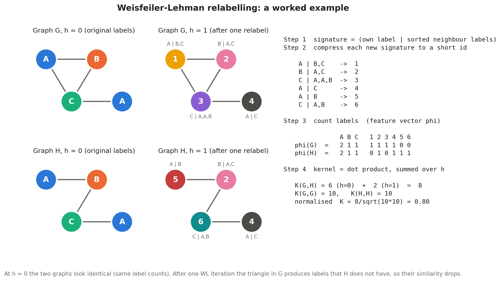
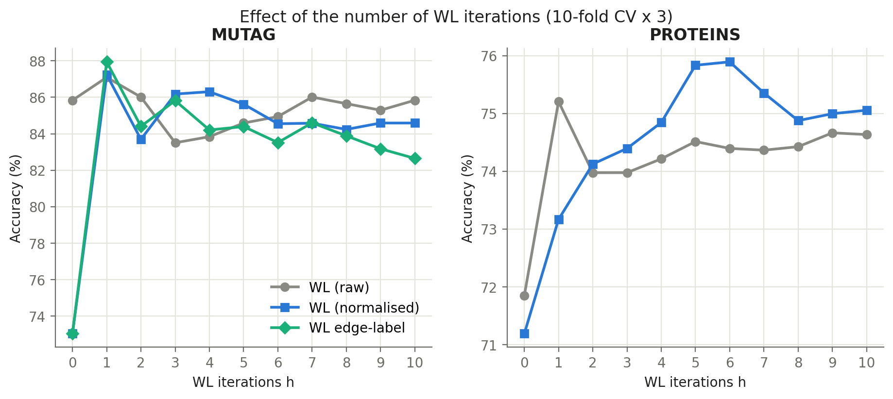
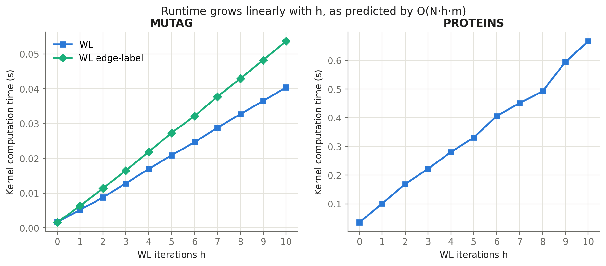

# Weisfeiler–Lehman Graph Kernel

A from-scratch implementation of the Weisfeiler–Lehman (WL) subtree kernel from Shervashidze et al., ["Weisfeiler–Lehman Graph Kernels"](https://www.jmlr.org/papers/v12/shervashidze11a.html) (JMLR 2011), with three modifications evaluated on the MUTAG and PROTEINS graph classification benchmarks.

The kernel is built with NumPy and SciPy sparse matrices only, without any graph-kernel library. scikit-learn provides the SVM, the cross-validation splitters and the metrics.



## Kernels

| Kernel | Definition |
|---|---|
| Standard WL subtree | K(G, G′) = Σᵢ₌₀ʰ ⟨φᵢ(G), φᵢ(G′)⟩, where φᵢ counts node labels after i WL iterations |
| M1: Normalised WL | K(G, G′) / √(K(G, G) · K(G′, G′)) |
| M2: Iteration-weighted WL | Σᵢ₌₀ʰ λⁱ ⟨φᵢ(G), φᵢ(G′)⟩, the paper's general WL kernel with weights αᵢ = λⁱ |
| M3: Edge-label WL | Relabelling signature uses (neighbour label, edge label) pairs |

## Results

Nested 10-fold stratified cross-validation repeated 3 times (30 test folds). Hyper-parameters (h, C, λ) are chosen by an inner 5-fold cross-validation on each training split. Values are mean percentages over the 30 folds; precision, recall and F1 are macro-averaged.

**MUTAG** (188 molecules)

| Kernel | Accuracy | Precision | Recall | F1 | ROC-AUC |
|---|---|---|---|---|---|
| Standard WL subtree | 86.00 | 85.12 | 85.69 | 84.57 | 92.83 |
| M1: Normalised | 87.05 | 86.57 | 85.65 | 85.35 | 93.81 |
| M2: Iteration-weighted | 86.53 | 86.13 | 85.09 | 84.79 | 94.13 |
| M3: Edge-label | 87.05 | 86.67 | 85.44 | 85.20 | 94.11 |

**PROTEINS** (1,113 proteins)

| Kernel | Accuracy | Precision | Recall | F1 | ROC-AUC |
|---|---|---|---|---|---|
| Standard WL subtree | 74.55 | 73.86 | 74.15 | 73.83 | 80.69 |
| M1: Normalised | 75.77 | 75.68 | 73.37 | 73.89 | 82.50 |
| M2: Iteration-weighted | 75.08 | 74.70 | 72.91 | 73.35 | 81.87 |

No difference from the standard kernel is statistically significant at α = 0.05 under the Nadeau–Bengio corrected resampled t-test; the closest is M1's ROC-AUC gain on PROTEINS (p = 0.052). Full tables with standard deviations and p-values are in `results/metrics_table.csv` and `results/significance.csv`.

Kernel computation time grows linearly with the number of iterations h, matching the O(N·h·m) bound: the full 1,113 × 1,113 PROTEINS kernel at h = 10 takes 0.67 s.

| Accuracy vs WL iterations | Runtime vs WL iterations |
|---|---|
|  |  |

## Repository layout

```
code/
  wl_kernels.py           WL relabelling, feature matrices, kernels, normalisation
  experiments.py          nested cross-validation, all experiments and metrics, runtime
  significance.py         corrected t-test and Wilcoxon test against the standard kernel
  make_figures.py         figures 1-6
  make_wl_example.py      worked WL example (figure 7)
  make_metric_figures.py  five-metric comparison, ROC curves, confusion matrices
  run_all.py              runs the whole pipeline
results/                  JSON results and CSV tables
figures/                  all figures
```

## Usage

Requires Python 3.10 or later.

```bash
pip install numpy scipy scikit-learn matplotlib torch torch_geometric
```

Run everything (about 17 minutes; the datasets download automatically on first run):

```bash
cd code
python run_all.py
```

Or run one step at a time:

```bash
python experiments.py MUTAG       # experiments on one dataset
python experiments.py --runtime-only
python significance.py
python make_figures.py
python make_metric_figures.py
```

All random splits use fixed seeds (0, 1, 2), so results are reproducible.

## Using the kernel

From inside `code/`:

```python
from wl_kernels import (load_tudataset, wl_relabel, feature_matrices,
                        per_iteration_grams, wl_kernel, normalize)
from sklearn.svm import SVC

graphs, y = load_tudataset("MUTAG", root="../data")
grams = per_iteration_grams(feature_matrices(wl_relabel(graphs, h=3)))
K = normalize(wl_kernel(grams, h=3))          # N x N kernel matrix

clf = SVC(kernel="precomputed", C=10).fit(K, y)
```

Pass `use_edge_labels=True` to `wl_relabel` for the edge-label variant, and `lam=` to `wl_kernel` for iteration weighting.

## References

- N. Shervashidze, P. Schweitzer, E. J. van Leeuwen, K. Mehlhorn and K. M. Borgwardt. Weisfeiler–Lehman Graph Kernels. *JMLR* 12:2539–2561, 2011.
- B. Weisfeiler and A. Lehman. A reduction of a graph to a canonical form and an algebra arising during this reduction. *Nauchno-Technicheskaya Informatsia* 2(9):12–16, 1968.
- C. Nadeau and Y. Bengio. Inference for the Generalization Error. *Machine Learning* 52:239–281, 2003.
- C. Morris et al. TUDataset: A collection of benchmark datasets for learning with graphs. *ICML GRL+ Workshop*, 2020.
